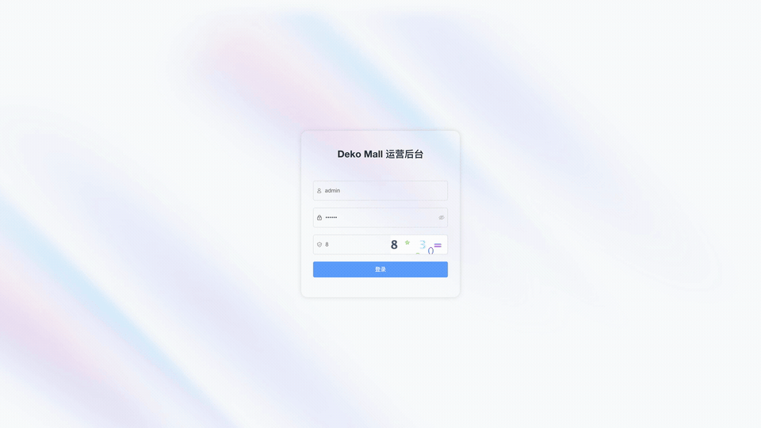
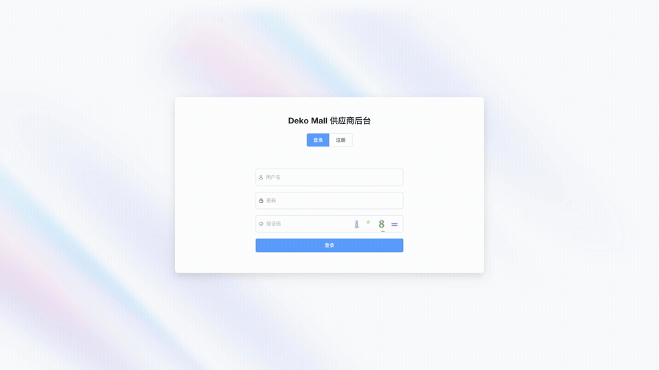
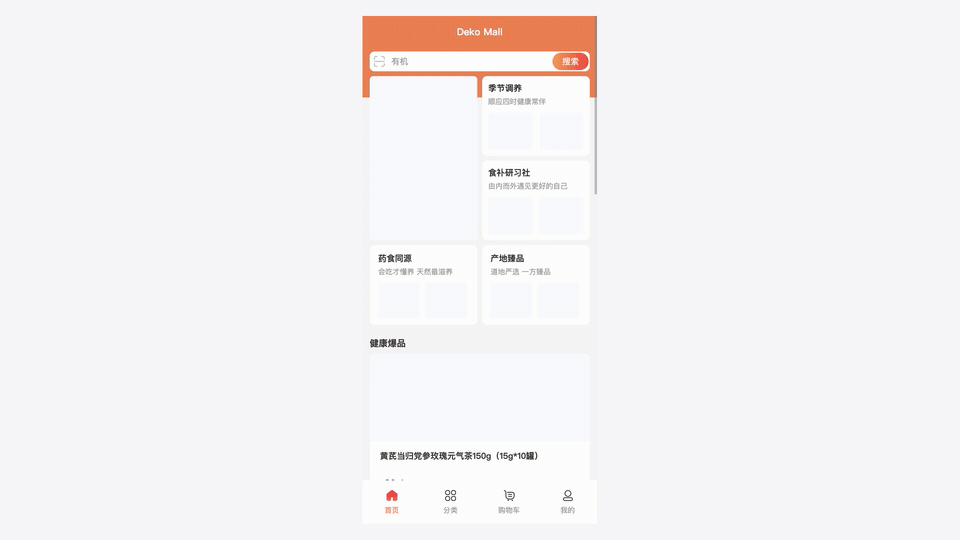

<div align="center">

# Deko Mall

**全栈微服务商城**

Java 17 · Spring Cloud Alibaba · Vue 3 · uni-app

[](https://openjdk.org/)
[](https://spring.io/projects/spring-boot)
[](https://spring.io/projects/spring-cloud)
[](https://vuejs.org/)
[](./LICENSE)

</div>

---

## 简介

运营后台、供应商后台、用户端（uni-app）三端一体，配套 9 个 Spring Cloud 微服务；Docker Compose 可一键启动。

## 快速开始

需 Docker Compose v2、JDK 17、Maven 3.9+（建议 Docker 内存 ≥ 8 GB）。

```bash
git clone https://github.com/zhlog1024/deko-mall.git
# 或：git clone https://gitee.com/zhlog1024/deko-mall.git

cd deko-mall
mvn clean package -DskipTests
cd deploy && docker compose up -d --build
```

会启动中间件、后端与两个管理后台（不含用户端；登录需验证码）。

| 地址 | 账号 |
| --- | --- |
| http://localhost:9527 | 运营 · `admin` / `123456` |
| http://localhost:9528 | 供应商 · `supplier` / `123456` |

部署细节、端口与排错 → [deploy/README.md](deploy/README.md)；用户端 → [mall-app/README.md](mall-app/README.md)。

## 演示

| 端 | MP4 | 内容 |
| --- | --- | --- |
| 运营 | [admin-demo.mp4](docs/demo/admin-demo.mp4) | 登录 → 首页 → 系统管理 → APP 配置 → 装修 |
| 供应商 | [scm-demo.mp4](docs/demo/scm-demo.mp4) | 登录 → 首页 → 商品列表 → 订单列表 |
| 用户端 | [app-demo.mp4](docs/demo/app-demo.mp4) | 首页 → 分类 → 详情 → 确认订单 → 个人中心 |





## 架构

```text
  ┌───────────────────────────────────────────────────────────────┐
  │  mall-admin 运营 · mall-scm 供应商 · mall-app 用户端          │
  └───────────────────────────┬───────────────────────────────────┘
                              ▼
                 ┌────────────────────────┐
                 │  mall-gateway   :9999  │
                 └───────────┬────────────┘
      ┌──────────┬───────────┼───────────┬──────────┐
      ▼          ▼           ▼           ▼          ▼
   auth:9000  system:8800  ums:8801  pms:8802  oms:8803
   sms:8804   pay:8806     cms:8808

  中间件：MySQL 8 · Redis 7 · RabbitMQ · Nacos · MinIO
```

## 功能

| 域 | 能力 |
| --- | --- |
| **商品** | SPU / SKU、分类、品牌、库存、运费、禁售区、评论 |
| **订单** | 下单、购物车、支付、发货、收货、售后、物流 |
| **支付** | 微信 / 支付宝 / 线下 |
| **会员** | 会员、积分、地址、收藏、浏览记录 |
| **营销** | 优惠券、广告、直播 |
| **内容** | 文章、视频、问答、协议、自定义页 |
| **装修** | DIY 楼层、首页模式、底部导航 |
| **App 配置** | 品牌 / 主题、登录、底栏、广告与协议等（入库即生效） |
| **系统** | 用户 / 角色 / 菜单 / 字典 / 附件 / 短信 / 小程序 |

## 技术栈

| 层 | 技术 |
| --- | --- |
| 后端 | Java 17 · Spring Boot 3.2 · Spring Cloud 2023 · Spring Cloud Alibaba · MyBatis-Plus · Nacos · OpenFeign |
| 存储 | MySQL 8 · Redis 7 · RabbitMQ · MinIO |
| 管理端 | Vue 3 · TypeScript · Vite · Element Plus · Pinia · UnoCSS |
| 用户端 | uni-app（微信小程序 / H5 / App） |

## 许可与致谢

本项目以 [Apache License 2.0](./LICENSE) 发布。部分模块衍生自下列开源项目，二次分发时请一并遵循其原许可：

| 来源 | 协议 | 本仓库中的使用范围 |
| --- | --- | --- |
| [youlai-mall](https://github.com/youlaitech/youlai-mall) | Apache 2.0 | 微服务后端骨架 |
| [vue3-element-admin](https://github.com/youlaitech/vue3-element-admin) | MIT | `mall-admin` / `mall-scm` 管理端脚手架 |
| [ShopXO](https://www.shopxo.net/) | MIT | `mall-app` 用户端，以及运营端 DIY 装修 |

完整版权声明见 [NOTICE](./NOTICE)。感谢有来开源组织与 ShopXO 社区。

## 联系方式

- 仓库：[GitHub](https://github.com/zhlog1024/deko-mall) · [Gitee](https://gitee.com/zhlog1024/deko-mall)（双端同步）
- 问题反馈：[GitHub Issues](https://github.com/zhlog1024/deko-mall/issues)
- 交流群：QQ `1051831704`
